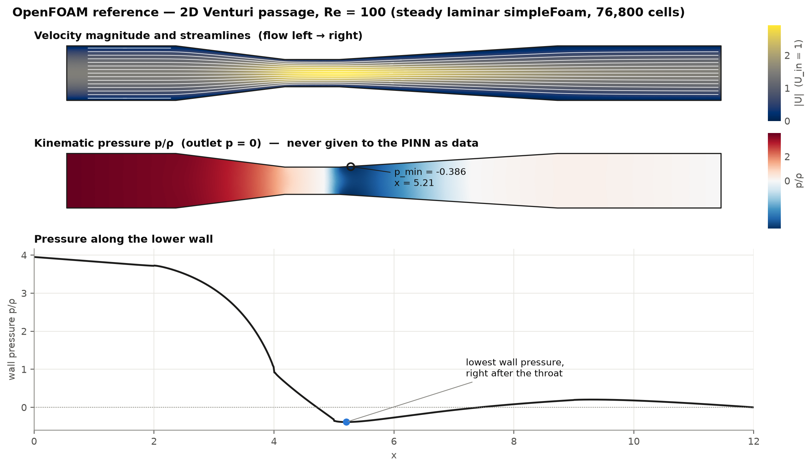
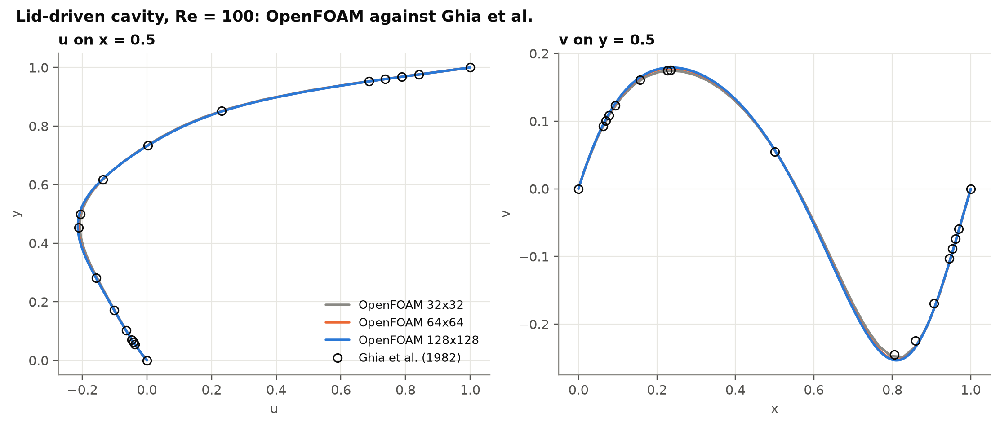
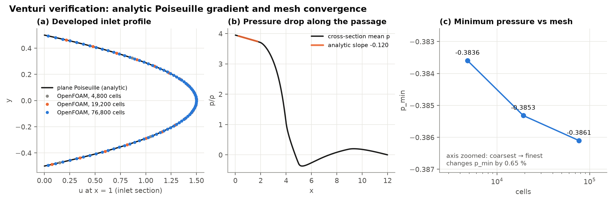
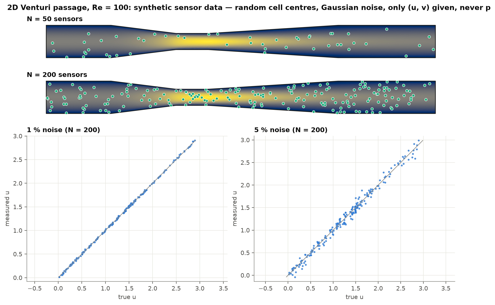
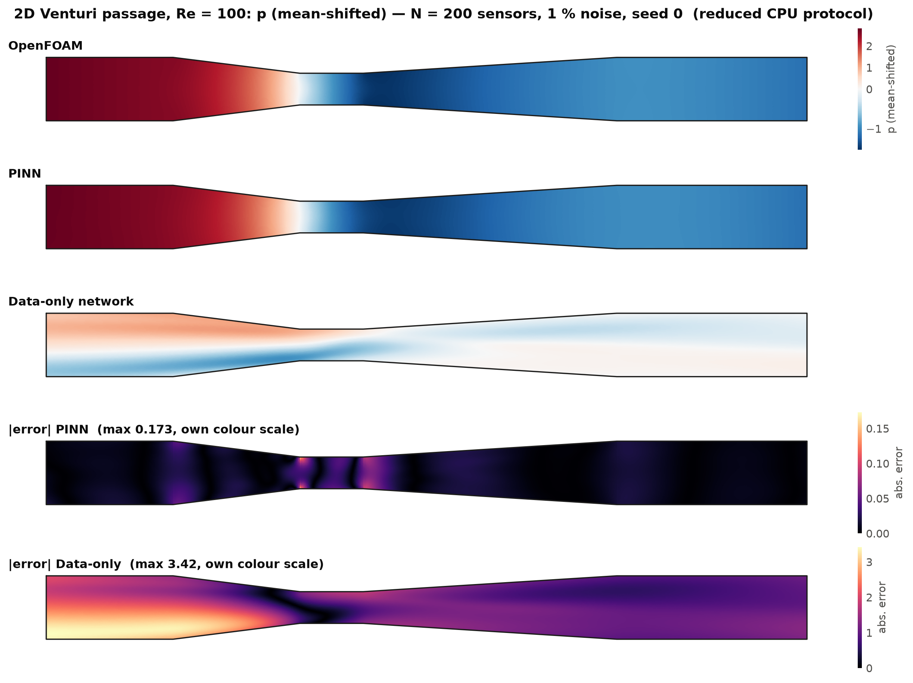
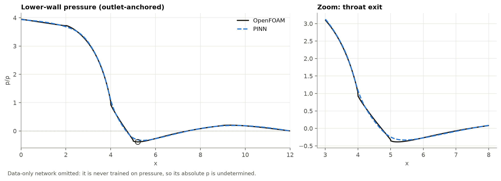
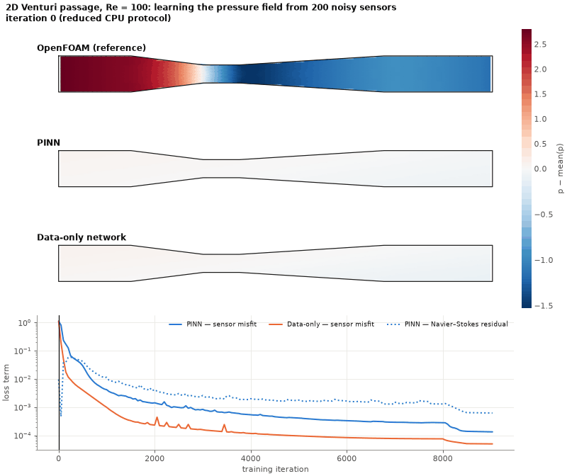
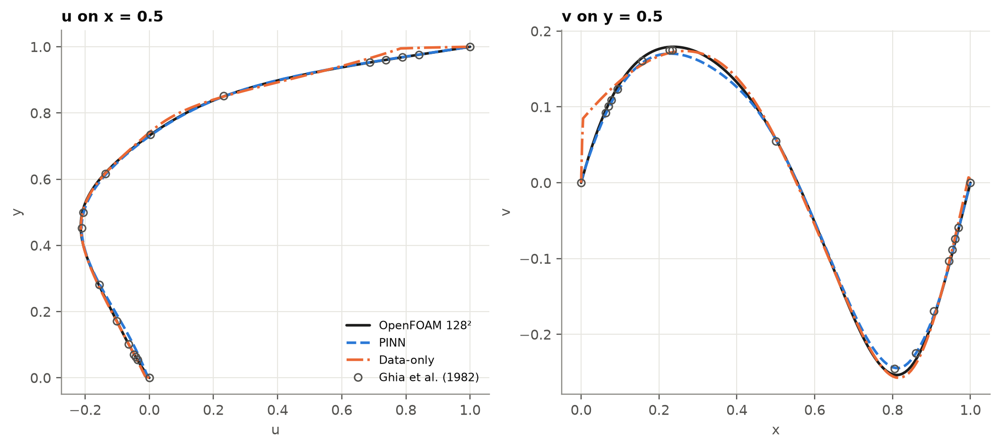
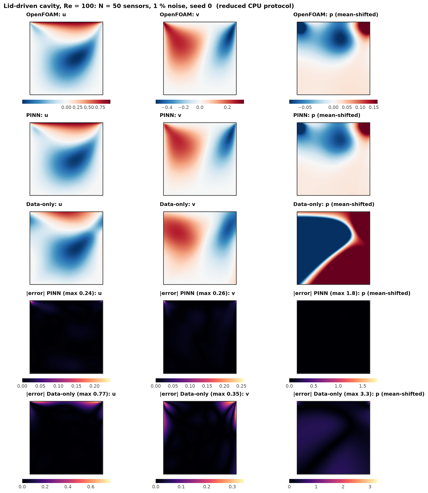
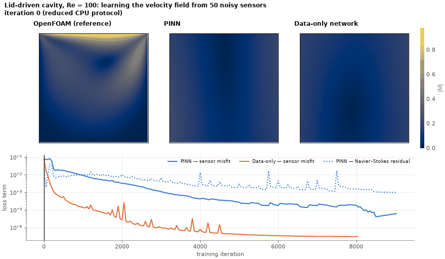

# PINN reconstruction of velocity and pressure from sparse noisy sensors
*Made with AI assistance.*


[](https://colab.research.google.com/github/vinothkannac/pinn-flow-reconstruction/blob/main/notebooks/colab_experiments.ipynb)

I wanted to find out how well a physics-informed neural network (PINN) can rebuild a steady flow field when it only
gets a few noisy velocity measurements, and what the physics term in the loss actually buys compared with a plain
network fitted to the same points. OpenFOAM provides the reference solution and also the "measurements": I pick random
cell centres from it and add Gaussian noise. The PINN never sees the pressure, so reconstructing the pressure is
the part I care most about.

Two cases, both steady, laminar, 2D, Re = 100:

* **Lid-driven cavity.** The standard test case. I use it to check my OpenFOAM setup against the Ghia et al. (1982) data and
  to check the PINN code on something well known.
* **Venturi passage.** A channel that narrows to half its height and opens up again. The pressure drops at the throat, and
  the question is whether the PINN finds where it is lowest, since that is where cavitation would start in a real
  liquid flow. This is single-phase flow only. Nothing here simulates cavitation itself.

> **Where this stands.** The OpenFOAM part is finished and verified for both cases. For the PINN I have so far only one
> run per model and case, with a reduced setup (see "PINN results so far"). The full experiment grid (three seeds,
> three noise levels, two sensor counts), the loss-weight tuning and the viscosity inverse problem are written
> but **not run yet**. So there are no mean and standard deviation tables, and I don't draw conclusions about how
> the PINN behaves in general.



## OpenFOAM reference

I used `blockMesh` for both meshes, so I did not need any external geometry. Both cases run with Allrun scripts
(`openfoam/cavity`, `openfoam/venturi`). OpenFOAM version is ESI v2606.

**Cavity.** `icoFoam`, unit square, lid velocity 1, nu = 0.01, meshes of 32², 64² and 128² cells, time step chosen so the
Courant number stays around 0.15 (the log maximum is 0.145, 0.152 and 0.156). Because `icoFoam` is transient I run to t = 100 and
check that the velocity changed by less than 1e-5 over the last 5 time units. It changed by about 1e-10 on all three meshes. I compared the centerline
profiles with the Ghia values, which I typed in from the paper myself (`data/cavity/ghia_re100.csv`). Deviations are in
units of the lid velocity, using the 15 interior points of each profile:

| mesh | u max | u RMS | v max | v RMS |
|---|---|---|---|---|
| 32 x 32 | 0.0033 | 0.0017 | 0.0088 | 0.0042 |
| 64 x 64 | 0.0034 | 0.0017 | 0.0087 | 0.0047 |
| 128 x 128 | 0.0048 | 0.0024 | 0.0091 | 0.0050 |

All of them are below 1 % of the lid velocity. What I find odd is that the deviation does not get smaller on finer meshes.
On the plot the three OpenFOAM profiles lie on top of each other, so I don't think the difference comes from my
mesh resolution. Possible reasons are the error in the 1982 solution itself, my linear interpolation to the Ghia points, or the
singular lid corners, but I have not tested which one it is. The lid corners are singular (the velocity jumps from 0 to 1), so
the solution there is not mesh-converged.



**Venturi.** `simpleFoam`, inlet height 1 with a parabolic profile and mean velocity 1, outlet pressure fixed to 0, no-slip walls.
Contraction to half height, a short throat, then a gentle diffuser. Three meshes (4,800, 19,200 and 76,800 cells); the finest is
the reference. Checks I could do without a benchmark:

* In the straight inlet section the pressure gradient should be that of plane Poiseuille flow, -12 nu U / H² = -0.12.
  I get -0.1196, -0.1204 and -0.1206 on the three meshes.
* Mass flux through a cross-section should be 1. At the stations I checked it is off by at most 0.13 % on the coarse mesh and 0.008 % on the fine one.
* The lowest pressure converges: -0.3836, -0.3853, -0.3861. It sits on the wall just after the throat exit (x = 5.21).



## The PINN

I used plain PyTorch because I wanted to write the residuals myself and see how they work. The network takes (x, y) and returns
(u, v, p). I chose tanh because the momentum equation needs second derivatives and ReLU has none. The inputs are scaled to [-1, 1]
(the Venturi is 12 long and 1 high) and the weights start with Xavier initialisation. Derivatives come from `torch.autograd.grad`.
The residual code is in `pinn/residuals.py`. I tested it on a Taylor-Green field where I know the answer (`tests/test_residuals.py`),
because a wrong residual would give me wrong results that still look plausible.

The loss is

    lambda_data * MSE(velocity at the sensors)
  + lambda_pde  * MSE(continuity and both momentum residuals at random interior points)
  + lambda_bc   * MSE(velocity on the walls and the inlet)
  + lambda_out  * MSE(p at the outlet)          (Venturi only)

with weights 1, 1, 10 and 1. I gave the boundary term the larger weight so the network does not ignore the walls. I have not tuned the
weights yet (`experiments/run_tuning.py` is ready). Collocation points are drawn at random inside the domain and replaced every 500 steps,
so the network cannot just fit one fixed set. Wall points sit at (i + 0.5)/n so the two lid corners of the cavity are never
used, because the velocity jumps there and I did not want the network to chase that. Training is Adam with cosine decay to get close,
then L-BFGS to polish. I save a checkpoint regularly so a run can be resumed, since Colab sessions get interrupted.

The **data-only baseline** is the same network and optimiser with the physics and boundary terms switched off.

**Pressure reference.** Pressure is only defined up to a constant in the cavity, so before computing any error I subtract the
mean over the cell centres from both the PINN and the OpenFOAM pressure. In the Venturi case the outlet condition p = 0 fixes the constant,
but I still use the same mean subtraction for the error numbers so that the two cases are treated the same way.

**Sensor data.** N random cell centres from the finest mesh, only u and v. Noise is Gaussian with a standard deviation
of 0, 1 or 5 % of the RMS of that velocity component over the whole field. I made it relative to the RMS so the noise scales with the flow.
The positions only depend on the seed, so the noise levels use the same points. I wrote the sensors to files in `data/<case>/sensors/`
so every run gets exactly the same data.



## PINN results so far

These are single runs with a reduced setup so that they finish on a laptop CPU: 4 layers of 64 units, 4,000 collocation points,
8,000 Adam and 500 L-BFGS iterations, float32. One seed, 1 % noise. The values are in `results/<case>/metrics_reduced.csv`.
Relative L2 error against the OpenFOAM fields at all cell centres:

| case | model | u | v | p |
|---|---|---|---|---|
| Venturi, 200 sensors | PINN | 0.0065 | 0.121 | 0.012 |
| Venturi, 200 sensors | data-only | 0.024 | 0.246 | 0.949 |
| Cavity, 50 sensors | PINN | 0.040 | 0.062 | 0.235 |
| Cavity, 50 sensors | data-only | 0.347 | 0.250 | 3.41 |

What I take from this, with the one-seed caveat:

* With the physics term the pressure comes out reasonably in the Venturi case. The data-only network has no
  information about pressure, so its pressure is meaningless. That is expected and is the point of the comparison.
* The PINN is clearly better than the data-only network on velocity as well, but it is a single run.
* The cavity pressure error of 0.235 is well above the 10 % I was aiming for. I don't know yet if that is due to the reduced
  setup, the weights, or the lid corners.
* The error in v for the Venturi PINN is large compared with u. I have not looked into it. The v component is small in this flow,
  which probably makes the relative error look bigger.
* On the Venturi pressure minimum the PINN gets -0.332 against -0.386 in OpenFOAM, a bit under 14 % too shallow, and the position
  is off by 0.58 length units along a channel that is 12 long. So it finds the right region but underestimates the dip, which you can see below.





The animation shows the pressure while training, with OpenFOAM on top, the PINN in the middle and the data-only network below
(MP4 versions are in `results/videos/`):



Cavity, for comparison with Ghia (the data-only network goes wrong near the walls and the corners):







More figures: `venturi_velocity_comparison.png`, `venturi_loss_curves.png`, `cavity_reference.png`, `cavity_sensors.png`,
`cavity_loss_curves.png`, and the videos `*_training_velocity` and `cavity_training_pressure`.

## Not done yet

* The experiment grid: `experiments/run_experiments.py` runs 3 seeds x 3 noise levels x 2 sensor counts x 2 models, plus the inverse problem
  (recovering nu from a first guess of 0.02, at N = 200 and 1 and 5 % noise). The inverse problem has only had a smoke test of a few
  iterations. A full-size run on the CPU is slow, so the grid is meant for Colab. `experiments/summarize_results.py` then builds the
  mean/std tables and the error-versus-noise and viscosity plots.
* The loss-weight tuning (`experiments/run_tuning.py`). It selects on a held-out set of noisy sensors and not on the reference field.
* The optional smoothed-lid variant for the cavity is not implemented.

## Limitations

2D, steady and laminar only. Real cavitating flow is turbulent and two-phase, so the Venturi case only covers the
pressure-reconstruction part. The "measurements" are synthetic, taken from my own CFD and not from an experiment, so
there is no measurement bias beyond the added noise. The sensor sets are tiny and the results depend on the loss weights.

## How to run

```bash
python -m venv .venv && source .venv/bin/activate
pip install -r requirements.txt
pytest -q
```

OpenFOAM (v2606 sourced) and the reference data:

```bash
(cd openfoam/cavity  && ./Allrun)           # the slow one (three transient runs); writes data/cavity/openfoam_N*.npz
(cd openfoam/venturi && ./Allrun)           # three meshes in parallel; writes data/venturi/openfoam_k*.npz
python scripts/preprocessing/make_sensors.py --case cavity
python scripts/preprocessing/make_sensors.py --case venturi
python scripts/verification/verify_cavity.py             # needs data/cavity/ghia_re100.csv
```

PINN on a CPU (a short test, then the grid):

```bash
python -m pinn.train --case venturi --model pinn --N 200 --noise 1 --seed 0 --device cpu --quick
python experiments/run_experiments.py --case venturi --device auto
python experiments/summarize_results.py --case venturi
python scripts/reporting/make_media.py --case venturi --what all --sub full
```

Colab: the badge at the top opens `notebooks/colab_experiments.ipynb`, which clones the repo, installs the requirements and runs
`experiments/run_experiments.py` on the free GPU. The committed data is enough, OpenFOAM is not needed there. A free GPU is not guaranteed and sessions
can be cut off, so runs are checkpointed and skip what is already finished when you start them again. The network is small, so the CPU
works too, only slower.

## Layout

```
openfoam/cavity, openfoam/venturi    case files and Allrun / Allclean
data/<case>/                         OpenFOAM reference fields, sensor files, Ghia values (cavity)
pinn/                                model, residuals, geometry, training, evaluation, plotting
experiments/                         run_experiments.py, run_tuning.py, summarize_results.py
scripts/openfoam/                    mesh generation, steady-state check, export of the fields
scripts/verification/                checks of the OpenFOAM results (Ghia, Poiseuille, mass flux)
scripts/preprocessing/               make_sensors.py
scripts/reporting/                   make_media.py (figures and videos)
tests/                               residual check and data/geometry tests
notebooks/                           Colab notebook
results/<case>/                      metrics, verification tables, histories, predictions
results/figures, results/videos
```

## References

* U. Ghia, K. N. Ghia, C. T. Shin, High-Re solutions for incompressible flow using the Navier-Stokes equations and a multigrid method,
  J. Comput. Phys. 48 (1982) 387-411.
* M. Raissi, P. Perdikaris, G. E. Karniadakis, Physics-informed neural networks: a deep learning framework for solving forward and inverse
  problems involving nonlinear partial differential equations, J. Comput. Phys. 378 (2019) 686-707.
